## What I'm building

- **A shopping app that starts with your camera.** Photograph or describe anything, and it shows where to buy it, compares prices, and finds the nearest open store. Eight languages, made for Hebrew and Arabic too.
- **Small tools I wanted for myself:** lyrics on a Discord status, an AI that listens to a song and writes out the words.

## Stack I like

`TypeScript` · `React` · `Supabase` · `Capacitor` · `Playwright`

## Say hi

Open an issue on any repo, or follow along here.
