


 

<b>I build apps, games and tools, and I ship them end to end.</b> 
Right now: <a href="https://statusong.com"><b>Statusong</b></a>, live lyrics on your Discord status. Based in Israel.

 

<a href="https://statusong.com"><b>statusong.com</b></a> &nbsp;·&nbsp; <a href="https://idank.co.il"><b>idank.co.il</b></a> &nbsp;·&nbsp; <a href="https://discord.gg/statusong"><b>Discord</b></a> &nbsp;·&nbsp; <a href="https://github.com/IdanKol/statusong"><b>Statusong on GitHub</b></a>


<h2>Featured</h2>

<a href="https://statusong.com"></a>

 

<a href="https://statusong.com">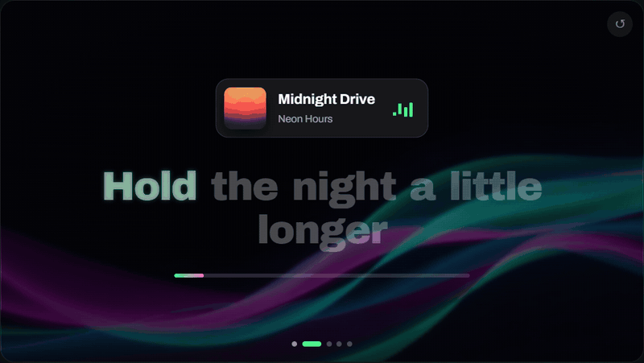</a>

  

<a href="https://idank.co.il"></a>

<h2>Also making</h2>

<a href="https://steamcommunity.com/sharedfiles/filedetails/?id=3818288354"></a>



<h2>Toolbox</h2>


 


